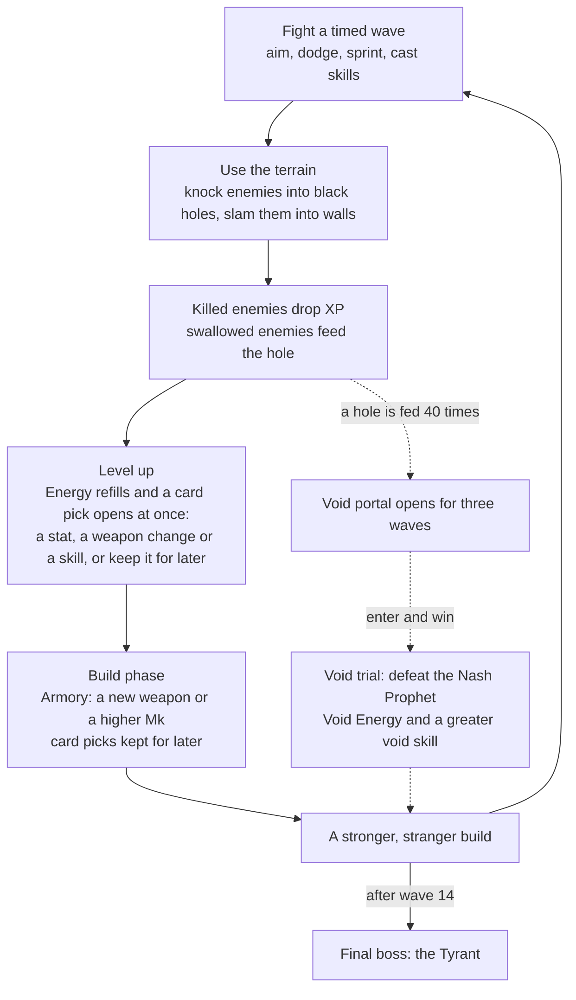

# WARP ARENA — Game Design Document

**A top-down arena survival game where your weapons misbehave and the map is your best weapon.** Knock monsters into black holes, slam them into walls, and feed a black hole until it opens a door to something worse.

| | |
|---|---|
| Genre | Top-down roguelike survival; a build grows inside each run, and the only thing that carries between runs is the player's own understanding of the game |
| View | Top-down play on a flat, bounded map; the camera follows the player and stops at the map edge |
| Platform | Web browser (Unity WebGL); mouse and keyboard |
| Engine | Unity 6 (URP) |
| A run | 14 timed waves with a build phase between them, then the final boss; roughly ten to fifteen minutes |

This document gives the big picture. The exact rules live in the system design document and every number in its companion numbers sheet; both change with tuning.

---

## 1. What the game is

Warp Arena is a roguelike survival game played in the browser with mouse and keyboard. The arena lies in warp space, and its power is behind everything strange in the game: it is what makes every weapon anomalous, it is what the skills draw on, and it shows itself on the field as black holes that swallow anything that enters them, with the void waiting behind.

What a weapon really does, and what it costs you, stays hidden until the moment you take it. During each wave you kill for experience, experience buys levels, and levels buy the weapons, skills and stats that get you through the next wave. Survive all fourteen waves and defeat the final boss, the Tyrant, to win.

Moment to moment you move, aim with the mouse, sprint out of trouble, swap between two hand weapons while two auto weapons act on their own, cast up to three skills, and keep looking for the wall or black hole that will do the killing for you.

## 2. Design pillars

| Pillar | How the systems deliver it |
|---|---|
| **Anomalous weapons, from first surprise to mastery.** | You pick a weapon without knowing what it does; the moment you take it, a weapon card shows the effect and its backfire. Every effect has a backfire, and nothing limits how often a weapon is used, so a trick can be practised. Later upgrades can soften a backfire, and a good player turns one into a move. |
| **The terrain is a weapon, for both sides.** | Walls deal slam damage and rebound whatever hits them. Black holes swallow everything, enemies and player alike. Enemies path around the holes on their own, but they can be knocked in. |
| **A build of your own, inside one run.** | Two hand weapons, two auto weapons, three skills and a set of stat cards. Enemy types, counts and the boss are fixed, and so is the pool of weapons and skills; what changes is the build you assemble from the first pick onward. Growth inside a run is the build; growth between runs is your own understanding of the game. |

## 3. Core loop

The inner loop is fight → grow → fight harder; every turn of it makes the build stronger and stranger. The dotted branch is the optional gamble, and losing it ends the run.

## 4. A run, start to finish

1. **Pick a starting weapon.** The title screen leads to a choice of three: Rifle, Knife or Rocket Launcher. Each weapon carries one of its form's two anomalies, rolled when the weapon is made and hidden until you choose. The moment you do, the game pauses on a weapon card that explains how it fires, what it does, what element it carries and what its backfire is.
2. **Fight a wave.** A short countdown with no enemies, then they arrive on a ring around you, preferably off screen, each spawn point marked by a red cross a moment before. While the wave timer runs, killing enemies only brings the next batch, so the field stays close to full. At zero, spawning stops and the survivors must be cleared. Every level gained raises max HP and max Energy, refills Energy and opens a card pick on the spot: the world freezes while you choose one of three. You can also keep the pick for later and reopen it during combat with T.
3. **Wave end.** The field freezes. Your statuses clear (Shield stays), corpses, projectiles and leftover orbs are removed, and HP is refilled before the next wave starts. Black-hole feed counts, open portals, weapons, upgrades, skills, Energy and stats all carry over.
4. **Build phase.** Time stays frozen. The Armory offers a new weapon or a higher Mk of one you hold; a new weapon can replace an old one, and it is revealed on its own weapon card. Then any card pick you kept during the wave is shown here. A wave has exactly one reroll, shared by the picks made during the wave and in its build phase. Tab puts the build panel away so you can walk the empty arena, and brings it back. Starting the next wave with picks still open asks you to confirm, then picks at random for you.
5. **The gamble (optional).** A black hole fed 40 times collapses into a portal that stays open for three waves. Step on it and press E to enter the void trial, from the build phase or in the middle of a wave. Dying inside, or falling off its platform, ends the run.
6. **The end.** After wave 14 comes the Tyrant. Kill it to win; if you and the Tyrant fall in the same instant, you win. Dying anywhere else brings the result screen, and a new run starts from there.

## 5. Main systems

**The player.** Survival comes from moving and aiming by hand, not from standing still and letting the build fire. The stamina bar is deliberately short, so a sprint is a decision: get clear of a projectile or a skill, open distance, or lead enemies into a black hole. Sprinting makes you much faster; it needs a minimum of stamina to start, then keeps going until you release the key or the bar runs dry, and the bar turns grey while it is below the starting threshold. Stamina refills on its own whenever you are not sprinting. Shield comes from Earth and from Bulwark: while you have it, damage is reduced and taken from the Shield first; it is capped at a share of your max HP and decays once you stop gaining it.

**States and getting hit.** Player and enemies share one set of states. Knocked back or thrown: no control until the slide nearly stops, and no resisting a black hole's pull meanwhile. Hooked: the hook owns your position, and nothing can push, pull or swallow you. Missile flight: no control, and immune to knockback only. Frozen cannot move; paralysed cannot act at all. Burning and poisoned only hurt. A hit from an ordinary enemy costs HP with clear feedback, a flash at the screen edge, a nudge of the camera, a flinch and a sound, but never knocks you back, so a crowd cannot take the controls away from you; only the bosses and the Stomper's slam knock you around, and a Rammer that hits you pushes you back a little and stuns you. Every hit is followed by a brief protection window; slamming into a wall ignores it.

**Damage, knockback and walls.** Damage is direct (weapons, collisions, some skills) or mechanical (statuses and the black holes, which simply kill). A hit resolves in order: a dead target ignores it; a protected target ignores it; Shield reduces it and absorbs it first; at zero HP the kill and its reward are paid once, and the corpse stays for a moment and can still be pushed into a hole; a surviving target is displaced by the attack's knockback tier; elements are applied last, and only to a living target. Tiers run from none (rapid-fire bullets, the throwing knife, Reverse Shot) through light, medium and heavy to launch (a full Charged Shot, the Tyrant's ground slam). Bigger bodies resist more, the Spire never moves, elites resist more than their ordinary kind, and bosses cannot be moved at all; knockback on a boss builds stagger instead, and a full bar stuns it for a while. A new knockback interrupts one in progress, so you can keep an enemy at arm's length. A knocked or thrown body that hits a wall, a pillar, the map edge or a Bulwark at speed takes slam damage, player or enemy, and rebounds with less force, sometimes into another wall or a black hole. Recoil that pushes you is not knockback and never causes slam damage. Bullets vanish on walls unless the weapon's bullets are built to bounce.

**Anomalous weapons.** A weapon is a form plus an anomaly, and each anomaly brings its own backfire. Each form has two anomalies; a new weapon rolls one of them, and the roll never changes. What you got is hidden until you choose the weapon, and then the game pauses on a weapon card. Nothing limits how often a weapon fires except cooldown, magazine and reload. You never hold two weapons of the same form. Two hand slots swap with the right mouse button, and a stowed weapon's cooldown keeps running; there is no unarmed attack. Two auto slots hold weapons that act on their own. Swapping needs a normal state: it cancels a charge, is refused while the hook is out or you are in missile flight, flings a hooked enemy first, and is allowed while the knife is out, which then returns to its own slot.

**Weapon strength and growth.** The six anomalies of the three starting weapons are tuned to the same strength; they differ in how they aim, how much they cover, how they control and what they cost, not in damage, so no opener is best. Every other weapon follows one rule: a weapon that hits hard hits few (one target, or a line that weakens), and a weapon that hits many starts weak and grows more, because damage and element cards apply to every hit. By mid-run all four slots are full. Damage growth comes only from the Armory, which offers higher Mk tiers of weapons you hold, so a weapon raised from the start is not easily replaced, changing builds has a cost, and the Armory stays worth opening late. Weapon cards from the draft change a weapon instead of inflating it: *Infusion* adds an element the weapon leaves on enemies (a new infusion overwrites the old; a built-in element cannot be replaced; hand and auto weapons alike), *Twist* adds a new variant of the anomaly (hand weapons), *Tame* removes or softens the backfire (hand weapons). Only a revealed weapon gets cards; Twist and Tame come once each per weapon; an infused weapon occasionally sees a card that swaps its element. A weapon's slot colour climbs with its upgrades, white, green, blue, orange, and a Void-infused weapon shows black. Upgrades belong to the weapon and leave with it when it is replaced.

**Elements and Shield.** Seven elements, each with one job: two deal damage over time, two control, three buff whoever wields them. Fire, Poison, Frost and Lightning stay on the target; Earth, Light and Void give something back to the wielder. Choosing an element card or an infusion is choosing a mechanic. Shield sits in front of HP and reduces direct damage, so what kind of damage you deal matters: burn is halved by it, poison ignores it, and the Railgun's Lance ignores it. Shield stops neither knockback nor status stacks. From mid-run some ordinary enemies spawn with an element affix, more of them and more kinds the later the wave, but each wave uses only two affixes, named on the wave banner before the fight; Wardens never carry one. An affixed enemy's hits put the element on you, and every status on you clears at the wave end, Shield excepted. Elites take their affix from all seven, each elite a different one. Only the Tyrant is immune to elements, two of them per run, and the Element Penetration card lets your elements work on an immune target at reduced strength.

**Skills and Energy.** Up to three skills on keys 1, 2 and 3: one press, one cast, toward or at the cursor; there are no channelled, toggled or passive skills. Energy appears, full, with your first skill. Its cap rises with level and with Energy Cap cards, and every time the XP bar fills, each level and each stat pick after the cap, Energy refills completely; whatever was unspent is wasted, so spend it. Beyond that, Energy trickles in from the Energy Cap card's kill bonus, Void-infused weapons, Devour and the Shield Ring's Leech, and it goes to skills, to the hits of Void-affixed enemies and to every shot of the Sentry Drone's Gunner. A press without Energy does nothing; each skill has a cooldown, but Energy is the real limit. You can cast while knocked back, not in missile flight, paralysed or frozen. Targeted skills have a maximum range, and a target inside a wall, a hole or off the map moves to the nearest legal point toward you, or the cast fails. Skills have three levels: a card for a skill you hold raises it, and with three skills held a new one replaces one of them and starts at level one. Seven element skills (one per element) and six mechanic skills, each basic or advanced, enter the card pool at fixed waves. After the void trial, Energy becomes purple Void Energy that regenerates on its own.

**Growth and cards.** Enemies within a wave are unlimited: the faster you kill, the faster you level and the more picks you earn, and the first levels come fast so a build takes shape early. Killed enemies drop XP orbs that are pulled to you; an orb that lands in a gravity ring drifts into the hole, and whatever is left on the ground vanishes at the wave end. Fodder gives a fixed amount; Spitters, Wardens and the other special enemies give more, and at the start of each wave the game sets their XP, and the elites', from the wave's composition so that experience per point of enemy health stays roughly steady; an affixed ranged or support enemy gives a little more; an elite gives several times a special; summons of a boss or of the trial give nothing. The level cap is 12. Each level needs more than the last, and the final levels take a large share of the whole. Every level raises max HP and max Energy, refills Energy and opens a card pick at once, freezing the world while you choose; Esc, Space or the pick-later button keep it for later, T reopens a kept pick during combat, and whatever is still unspent is shown in the build phase. Past the cap the bar keeps filling, and every fill gives a pick of three random stat cards. A normal pick shows three different cards: a stat card, a weapon card for a revealed weapon's untaken upgrade, and a skill card (a new skill while you hold few, mostly upgrades once you hold three). Each wave has exactly one reroll, shared by the picks made during the wave and in its build phase. Stat cards come in five rarities, common to legendary; most are common, the top tiers are rare, and a long run without a good card guarantees one. The card pool's rarities and skill tiers rise at fixed waves.

**Enemies and waves.** Each enemy asks the player one question, and no two ask the same: three basic roles (melee, ranged, support) and six special roles (buff, control, self-destruct, sentinel, displacement, assassin). Enemy health is set by what a normal build can put out in that wave, not by your current damage: fodder breaks at a touch, specials take a moment, elites take a while, and a boss is a fight of a minute or two, so a strong build plays faster without a weak one being walled. From mid-run enemies hit harder every wave and move slightly faster, and elites hit harder than their ordinary kind; enemies are kept deliberately slow so there is room to move and to use the terrain. They path around walls, holes and gravity rings and never walk into a hole themselves, with one exception: fast enemies follow you into a ring, where the pull outruns them, so standing at a ring's edge is a way to feed the hole. The Rammer's charge turns for nothing. Wave 1 is Grunts only; Spitters join at wave 2 and Wardens at wave 3; the specials arrive one or two kinds at a time from the early waves on, and Shades only in the last two. Early waves ramp gently so you learn the weapons and movement before the crowd. Enemies spawn on a ring around you, preferably off screen, never in a wall, a hole, a gravity ring or under your feet, each spot marked by a red cross first. Elites appear from mid-run, drawn from the six special types, at most three at once and each with a different affix; they are tougher, hit harder and resist knockback more, wear a buff label beside their health bar, and have a small chance to drop a health or Energy orb. When the timer hits zero, spawning stops and pending spawn marks disappear, but the fight runs until the last enemy is down.

**Black holes, the portal and the void trial.** Each run has two black holes, one large and one small, placed at random from the layout's preset spots. Anything that enters one is swallowed: player, enemies, XP, health and Energy orbs, projectiles; a knife that falls in is lost, anything flying over it is taken, and only fields on the ground are spared. The gravity ring around a hole pulls everything inward harder than walking, so without sprinting you cannot get out and are slowly drawn in; a sprint crosses it, at the cost of most of your stamina. Every enemy swallowed counts once toward its hole, an elite the same as a Grunt, and a corpse pushed in counts too, but an enemy swallowed alive gives no XP: feeding is trading growth for a chance at the trial. At 40 the hole collapses, its shrinking area still killing but no longer pulling or counting, and becomes a harmless portal for three waves, not counting the one it opened in. Only one portal exists at a time, and while it is open the other hole still pulls and kills but does not count. An unused portal expires and takes its hole with it; the other hole keeps counting, so a run gets one more chance. The trial is a circular platform floating in the void, shrinking with the boss's phases, and its edge is death. Enter from the build phase and you return to it; enter during a wave and the battlefield freezes until you come back to the portal's spot, with a short pause before the wave resumes. Winning turns Energy into self-regenerating Void Energy and offers one of three greater void skills, which you may decline, and makes every black hole vanish. You carry Void only once the void boss is beaten and a void skill is equipped, a Void-infused weapon alone does not count, and from then on Light-affixed enemies hit you harder.

**The arena.** A bounded rectangle; you start at its centre, and the camera follows you until the edge. The edge and the walls, straight and L-shaped, block movement and projectiles, and the slam and rebound rules apply to all of them. Three looks, each with its own wall layouts, and a black hole's possible positions come with the layout.

**Readability.** The wave banner names the wave's two affixes before it starts; a red cross marks every spawn point; elites wear a buff label beside their health bar; the stamina bar greys below the sprint threshold; the Energy bar appears with your first skill and turns purple after the trial. One colour scale runs through the game: white, green, blue, purple, orange for card rarity, black for Void, weapons coloured by their upgrades and skills by their level. At the cap the level reads MAX, in purple if the trial is won. A card panel or menu ignores clicks for a moment after opening and until the fire button is released, so a level-up in the middle of a fight never picks a card for you.

## 6. Content

### Hand weapons (11 forms, 22 anomalies)

| Form | Anomaly | What it does | Backfire |
|---|---|---|---|
| Rifle | Charged Shot | Hold to charge, release a shot that pierces a whole line; a fuller charge hurts more and pushes farther. | You walk very slowly while charging. |
| Rifle | Reverse Shot | Hold to fire a stream; the bullets bounce off a wall once; reload when the magazine is empty. | The bullets leave from your back. |
| Knife | Throwing Knife | The knife bounces between a few nearby enemies, then returns to the spot you threw it from, not to you. | After a kill it comes straight back and hurts everything on its path. |
| Knife | Hook | Hooks the first enemy and drags it in front of you as a shield; click again to fling it into the others. | You cannot move while the hook goes out or comes back. After it comes back empty or flings an enemy, it needs a moment before it can go out again. |
| Rocket Launcher | Strike | Marks the ground under the cursor; a moment later a rocket falls and blasts the area. | The blast is late, and it hurts you as much as them. |
| Rocket Launcher | Human Missile | You become the rocket and hurt every enemy on your path. | Hitting a wall costs HP; a black hole on the path swallows you. |
| Scatter Cannon | Blast | A short cone of pellets; the closer, the more it hurts; two shots, then reload. | A reload can jam at random and must be cleared before you fire again. |
| Scatter Cannon | Focus | Hold to gather every pellet into one point, then fire a fast burst that reaches far. | The recoil throws you a long way backward. |
| Flamethrower | Stream | Hold to spray fire ahead and ignite the cone (built-in Fire). | Getting hit while spraying bursts the tank, burning everything around you, and you. |
| Flamethrower | Wildfire | Lobs a fireball that leaves burning ground where it lands; up to three patches at once. | Your own fire burns you. |
| Cryo Cannon | Shatter | A fan of three flying ice shards, each enemy hit by at most one per shot; double damage against a frozen target (built-in Frost). | The shards leave ice where they stop that stacks Frost on you when you step on it, though never enough to freeze you. |
| Cryo Cannon | Blizzard | Hold to spray snow that freezes quickly and keeps enemies frozen as long as you spray. | You move slower while spraying. |
| Arc Coil | Chain | An arc hits the nearest enemy in a cone ahead of the crosshair and jumps between nearby enemies several times, never through walls; with nobody ahead it does not fire (built-in Lightning). | With too few enemies to jump to, the arc comes back to you, and enough of it paralyses you. |
| Arc Coil | Capacitor | Charges as you walk with it in hand, faster with enemies close; click to discharge it on everything around you, harder when full. | Held full for too long, it discharges on you by itself. |
| Venom Launcher | Cloud | Lobs a pod that bursts into a lingering poison cloud (built-in Poison). | The fading cloud leaves spore pods that burst on whoever steps on them: enemies are poisoned, and you lose HP. |
| Venom Launcher | Needler | Hold to fire poison needles, each stacking Poison; reload when empty. | Firing costs you HP. |
| Railgun | Lance | A short wind-up, then a slug that pierces a line and ignores Shield; each target behind the first takes less. | The recoil truly knocks you back, into a wall behind you or into the crowd. |
| Railgun | Execute | A single heavy hit that kills a weakened enemy outright; every kill raises the execution threshold. | Every execution lowers your max HP. |
| Minigun | Spin-up | Hold to fire; the rate climbs the longer you hold. | The faster it spins, the slower you can turn to aim. |
| Minigun | Meltdown | Full rate from the first shot, but heat builds while you fire. | Overheating explodes beside you and stops the gun for a while. |
| Swarm Launcher | Barrage | A swarm of small rockets that burst on enemies. | They leave at random angles, some straight into your face. |
| Swarm Launcher | Carpet | A chain of blasts walking in a straight line away from you. | The first blast is right in front of you; walk forward and you walk into it. |

### Auto weapons (3 forms, 6 anomalies)

| Form | Anomaly | What it does | Backfire |
|---|---|---|---|
| Orbit Blades | Saw | Blades circle you; enemies they touch are hurt and pushed outward. | They bat XP orbs away too. |
| Orbit Blades | Magnet | Blades circle you; enemies they touch are hurt and pulled inward. | Enemies end up dragged into your face. |
| Sentry Drone | Gunner | A drone shoots the nearest enemy on its own. | Every shot costs Energy; when Energy is gone, it stops. |
| Sentry Drone | Whirl | A drone grabs an enemy, swings it around you and slams it into the others. | You do not choose where it lets go, and the swung enemy blocks your bullets. |
| Shield Ring | Repulsor | Every so often, shoves everything near you hard and deals a little damage. | XP orbs, and the crowd you just lined up, scatter with it. |
| Shield Ring | Leech | Drains HP from nearby enemies and turns it into your Energy. | Part of what it drains flows into the weakest wounded enemy in the ring. |

### Elements

| Element | Kind | On the target (your weapons and skills) | As an enemy affix |
|---|---|---|---|
| Fire | Damage over time | A fast-ticking burn, reduced by Shield; each tick removes a stack | Its hits set you burning |
| Poison | Damage over time | A slow, long poison that ignores Shield; each tick removes a stack | Its hits poison you |
| Frost | Control | Slows movement and attacks; at full stacks the target freezes and takes extra damage; fades over time | Its hits stack Frost on you |
| Lightning | Control | Spreads between targets; at full stacks the target is paralysed in bursts, and hitting a paralysed enemy deals extra damage, more for every paralysed enemy near it; fades over time | Its hits stack Lightning on you |
| Earth | Buff | Gives the wielder Shield | It spawns with Shield |
| Light | Buff | Heals the wielder for a share of its damage; counters Void | It heals for a share of the damage it deals, and hits a Void carrier harder |
| Void | Buff | Restores the wielder's Energy | It acts more often, and its hits drain your Energy |

### Skills (13, plus 3 greater void skills)

| Skill | Element · tier | What it does | Levelling up |
|---|---|---|---|
| Flame Wake | Fire · basic | For a while a burning trail follows you; enemies that touch it catch fire | Lasts longer; at max level the trail is wider |
| Contagion | Poison · basic | Poisons nearby enemies; for a while, a poisoned enemy that dies passes its poison to a neighbour | Lasts longer; at max level each death infects two |
| Frost Nova | Frost · basic | Stacks Frost on everything around you; fodder freezes on the spot | Bigger; at max level the freeze lasts longer |
| Storm Call | Lightning · basic | Random lightning strikes near the cursor, hurting and stacking Lightning | More bolts over a wider area; at max level a bolt that hits chains to nearby enemies |
| Bulwark | Earth · basic | Raises an indestructible wall at the cursor that enemies slam into and bounce off, and gives you Shield scaled to your max HP | Thicker Shield, farther knockback, longer wall; at max level the Shield is very thick |
| Radiance | Light · advanced | Clears every status on you; for a while your attacks heal you and you resist statuses | Longer, more resistance; at max level it also heals at once |
| Devour | Void · advanced | Swallows one weakened enemy nearby and restores Energy | A higher health threshold; at max level a shorter cooldown |
| Blink | Mechanic · basic | Teleports you toward the cursor and cancels a knockback in progress | Farther; at max level two uses |
| Shockwave | Mechanic · advanced | Shoves every enemy around you hard | Bigger; at max level it also reflects enemy projectiles |
| Gravity Well | Mechanic · advanced | A well at the target that pulls nearby enemies to its centre for a while | Longer; at max level it explodes when it ends |
| Time Slip | Mechanic · basic | Everything but you slows down for a while | Longer; at max level your attacks are faster meanwhile |
| Decoy | Mechanic · advanced | Places a mirror of you that enemies chase | Longer; at max level it casts a random other skill when it dies |
| Overcharge | Mechanic · basic | All your weapons fire much faster for a while | Longer; at max level it also adds damage |

The greater void skills appear only after the trial is won, as a choice of one from three, and never level up.

| Greater void skill | What it does |
|---|---|
| Pocket Void | Opens a small black hole at the cursor that swallows anything but a boss, and you receive the XP of what it swallows |
| Void Walk | You slip into the void: faster, untargetable and unhurtable, until it ends |
| Singularity | Drags every enemy on screen toward you and slows them while you hang in place like a black hole, then you explode; the more pulled in, the more it hurts |

### Stat cards

| Card | Main effect | Side effect |
|---|---|---|
| Max HP | More max HP, and heals the same amount when taken | Heals a little over time |
| Move Speed | Walk faster | Sprint lasts longer |
| Damage | All damage up | Crit chance up |
| Attack Speed | Shorter weapon cooldowns | — |
| Crit | Crit chance up | Crit multiplier up |
| Protection | Armour that reduces the damage you take | — |
| Energy Cap | Higher max Energy (appears once Energy is unlocked) | A little Energy for every enemy that dies |
| Element Penetration | Your elements work on an immune target at reduced strength | — |

### Enemies

| Enemy | Role | Behaviour |
|---|---|---|
| Grunt | Basic · melee | Walks up, locks its facing and punches. Three bodies: the Brute winds up long, hits hard and is slow; the Skitter is fast with a short wind-up but weak; the Splitter sits between them and splits into small Splitters when killed. |
| Spitter | Basic · ranged (from wave 2) | Keeps its distance, charges when it has line of sight, and fires a poison spike. |
| Warden | Basic · support (from wave 3) | Never attacks; hides behind allies and shields those around it, topping them up over time. Never carries an affix. |
| Chanter | Special · buff | Never attacks; hides behind allies and chants, raising the damage of every ally in range. |
| Rammer | Special · control | Draws a charge line, then charges along it without turning; a player it hits is pushed back a little and stunned. A wall stuns it; a black hole swallows it. |
| Bloater | Special · self-destruct | Walks at you; within about 7 cells it turns yellow and rushes you, then swells and explodes almost as soon as it reaches you, hurting everything; it explodes when killed too, and leaves a radiation patch that hurts you. |
| Spire | Special · sentinel | Never moves. Draws a warning circle, sends out a pulse that hurts only the player, then locks on a player inside the circle and fires a laser. |
| Stomper | Special · displacement | Closes in, winds up and slams a small cone in front of it toward you, launching everything in it; you are thrown far back. Spawns with Shield, away from the crowd. |
| Shade | Special · assassin | Announces itself with its own colour and sound, shows for a moment, then cloaks; its strike can kill you outright. Any damage reveals it, its health is very low, and only a few exist at once. |

### Bosses

| Boss | Where | What it tests |
|---|---|---|
| The Nash Prophet | The void trial | Positioning: using the platform's terrain and dodging its projectiles. It has no Shield, is always immune to Lightning and Frost, cannot be pushed, and its summons give no XP; the platform shrinks with each of its phases. Up close it pulses you away and inhales; at range it fires predictive shots and rings of bullets; in its last phase it marks landing zones that become holes. Its own hits never push you off the platform or into a hole, and pushing its summons off the platform hurts it. |
| The Tyrant | After wave 14 | The whole build: a thick, shielded single target (do you have high damage or Shield-piercing?), it gathers crowds (do you have area damage?), and it is immune to two random elements fixed at the start and announced at wave 11 (is your damage one-note?). It re-shields at every new phase and cannot be pushed; knockback builds stagger instead, and a full bar stuns it for a while. Its hits, like the Nash Prophet's, knock you back. It picks moves by distance: a cleave up close (with a back slash from phase 2), a slam and a charge at mid range, a leap from afar. A charge into a wall, a Bulwark or a black hole stuns it, strips its Shield and costs it HP. |

### Biomes

Dust Flats, Wreck Field and Rift Zone: each is a look with its own wall layouts.

## 7. Controls

| Action | Input |
|---|---|
| Move | WASD |
| Aim | Mouse |
| Use the held weapon | Left mouse button (hold to charge or to keep firing, depending on the weapon) |
| Swap the two hand slots | Right mouse button |
| Sprint | Hold left Shift |
| Cast a skill / select a card while a card panel is open | 1, 2, 3 |
| Open the banked card pick during combat / switch art mode on the title screen | T |
| Put the build panel away to walk the empty arena, and bring it back | Tab |
| Enter the void trial | E while standing on the portal |
| Start, open the crate, close the weapon card, start the next wave; pick later on a mid-wave card panel | Space or Enter |
| Pause / resume; pick later on a mid-wave card panel | Esc |
| Reroll while a card panel is open (once per wave) / restart on the result screen | R |

## 8. External References

AI tools used in making the game:

| Tool | Used for |
|---|---|
| Meshy | 3D models and character animation |
| ElevenLabs | Sound effects and music |
| Claude | Building the UI and VFX, and bringing these art assets into the game |

Other external software and packages (versions from the project's package manifest):

| Resource | Version | Used for |
|---|---|---|
| Unity | 6000.6.3f1 | Game engine and WebGL build |
| Universal Render Pipeline (`com.unity.render-pipelines.universal`) | 17.6.0 | Rendering |
| Input System (`com.unity.inputsystem`) | 1.20.0 | Mouse and keyboard input |
| Localization (`com.unity.localization`) | 1.5.13 | English and Chinese UI text |
| uGUI (`com.unity.ugui`) | 2.6.0 | HUD and menus |
| Cinemachine (`com.unity.cinemachine`) | 6.6.0 | Installed camera package |
| Test Helper (`com.nowsprinting.test-helper`, via OpenUPM) | 1.6.4 | Helpers for the automated Play Mode tests |
