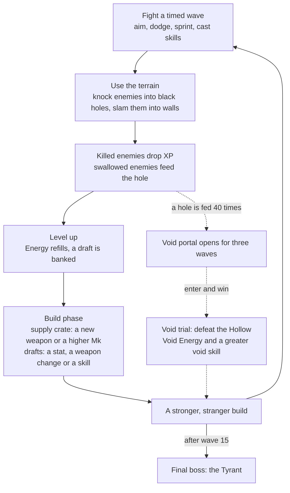

# WARP ARENA — Game Design Document

**A top-down arena survival game where your weapons misbehave and the map is your best weapon.** Knock monsters into black holes, slam them into walls, and feed a black hole until it opens a door to something worse.

| | |
|---|---|
| Genre | Top-down arena survival; a build grows inside each run, nothing carries over between runs |
| View | Top-down 3D; the camera follows the player across a bounded map |
| Platform | Web browser (Unity WebGL), desktop Chrome, Edge or Firefox; mouse and keyboard |
| Engine | Unity 6 (URP) |
| A run | 15 timed waves and a final boss: about 11 minutes of wave combat, plus build phases and the boss fight |
| Origin | Grew out of an earlier single-arena prototype with three weapons |

This document gives the big picture. Exact rules, numbers and edge cases are kept in separate design notes and change with tuning.

---

## 1. What the game is

Earth is under attack, and its first line of defence is an interstellar battlefield outside the solar system. You are the last explorer of your squad. Survive wave after wave of alien monsters until the evacuation ship arrives, then defeat the Tyrant who comes to stop it.

A strange interstellar energy saturates the battlefield and distorts every weapon: a rifle may fire out of your back, a knife may become a hook, a rocket launcher may launch *you*. Under the battlefield lies a deeper force, the void, which shows itself as black holes that swallow anything that falls in.

Moment to moment you move, aim with the mouse, sprint out of trouble, swap between two hand weapons, cast up to three skills, and keep looking for the wall or black hole that will do the killing for you.

## 2. Target experience

| The player should feel | Because |
|---|---|
| **Surprise, then mastery:** "It does *what*? … Oh, I can use that." | Weapon effects are hidden until first use, every effect has a backfire, and there is no use limit, so a trick can be practised. |
| **"The map did the killing."** | Attacks push enemies different distances; walls make them slam and rebound; black holes swallow anything, and enemies avoid holes on their own. |
| **"My build came together."** | Weapons, elements, skills and stat cards are chosen one at a time between waves, and they combine. |
| **"Do I risk it?"** | Feeding a black hole costs XP and terrain, opens a door for only three waves, and losing what waits behind it ends the run. |

## 3. Design pillars

1. **Anomalous weapons.** Familiar form, hidden function, a backfire on every one. The backfire is part of the weapon: a good player turns it into a move.
2. **The terrain is a weapon — for both sides.** Anything that can kill an enemy can kill you: black holes, gravity, walls, your own explosions.
3. **A build that grows.** Levels buy cards; weapons, elements and skills all get stronger and stack into a plan.
4. **A hidden door.** Feeding the void is optional, costly and dangerous, and winning the trial behind it changes the rest of the run.
5. **One job per piece.** Every enemy asks one question, every element does one thing, every upgrade changes one aspect of a weapon, so a player can learn the whole game within a run.

## 4. Core loop

The inner loop is fight → grow → fight harder. The dotted branch is the optional gamble.

## 5. A run, start to finish

1. **Pick a starting weapon:** Rifle, Knife or Rocket Launcher. Which of its two anomalies you got stays hidden until you fire it.
2. **Fight a wave.** Enemies keep arriving around you while the wave timer runs. At zero, spawning stops and the survivors must be cleared. Waves grow from 30 to 50 seconds and from a handful of enemies to a crowd.
3. **Wave end.** Every orb on the map flies to you, HP is restored and statuses clear.
4. **Build phase.** The battlefield freezes. A supply crate drops; open it to see the Armory (three offers: a new weapon, or a higher Mk of one you hold). Then pick one card from a draft of three for every level gained in the wave.
5. **The gamble (optional).** A black hole fed 40 times collapses into a portal that stays open for three waves. Step on it and press E to enter the void trial. Losing the trial ends the run.
6. **The end.** After wave 15 comes one last build phase, then the Tyrant. Kill it to evacuate and win.

## 6. Main systems

**Anomalous weapons.** Each weapon form has two anomalies; a new weapon rolls one of them, hidden until first use. Every anomaly has a backfire, from recoil that can walk you into a black hole to a corpse that flies back at you. You carry two hand weapons (right mouse button swaps) and up to two auto weapons that act on their own. There is no unarmed attack.

**Weapon growth.** Damage growth comes from the Armory, which offers higher Mk tiers of weapons you already hold. Draft cards change a weapon instead of inflating it: *Twist* adds a behaviour, *Tame* softens the backfire, *Infusion* adds an element.

**Elements and Shield.** Seven elements, each with one job. Fire, Poison, Frost and Lightning stay on the target; Earth, Light and Void give something back to whoever wields them. Shield sits in front of HP and cuts direct damage; burn is halved by it and poison ignores it, so which damage you deal matters. Enemies with an element affix use the same rules against you.

**Skills and Energy.** Up to three skills on keys 1–3: one press, one cast. Energy unlocks with the first skill and refills completely at each level-up, so it should be spent, not saved. Late in a run Energy gets scarce on purpose; leech effects and the void trial are the ways out.

**Black holes, gravity and walls.** Each run has two black holes, one large and one small, placed at random from fixed spots. Anything whose centre enters one dies, player included. A gravity ring around each pulls everything inward, and only sprinting gets you out. Walls and the map edge make knocked bodies slam, take damage and rebound, sometimes into a hole.

**The void portal and the trial.** Enemies swallowed alive give no XP but count toward their hole; a damage-killed corpse can still feed a hole once, without a second reward. At 40 the hole becomes a portal for three waves. Inside, the Hollow waits on a floating platform, and pushing its minions off the edge is how you hurt it. Winning turns Energy into self-recharging Void Energy and grants one of three greater void skills, but from then on you carry Void, and Light-affixed enemies hit you harder.

**Growth.** Killed enemies drop XP orbs that fly to you. There are ten levels; each one adds max HP and max Energy, refills Energy and banks a draft. A draft offers a stat card, a weapon card and a skill card. After level 10 every further bar becomes a stat-only draft. Stat cards come in five rarities.

**Enemies and waves.** Three basic types fill every wave. Five special types appear only as elites, from wave 6, at most three at a time and each with a different element. From wave 5 some ordinary enemies carry an element affix, and the wave banner names the two in use. Enemy toughness follows a fixed per-wave budget: fodder falls in well under a second to an ordinary build, elites take several seconds, bosses about a minute.

**Hit feel.** Hits never slow the game down; all feedback stays local. Melee hits freeze the struck enemy for an instant, heavy shots kick and flash, rapid fire only shakes the target, and area damage barely moves it. Ordinary enemies and elites make the player stagger for a moment instead of knocking them back; only bosses still knock the player around.

## 7. Content

### Hand weapons (12 forms, 24 anomalies)

| Form | Family | Anomalies | In one line |
|---|---|---|---|
| Rifle | Trick | Charged Shot · Reverse Shot | A charged shot that pierces a line, or bullets that leave from your back and push you forward. |
| Knife | Trick | Throwing Knife · Hook | A knife that ricochets between enemies and drags a corpse back, or a hook that holds an enemy so you can fling it. |
| Rocket Launcher | Trick | Strike · Launch Yourself | A rocket that lands where you pointed a moment later, or you become the rocket. |
| Grav Gun | Trick | Attract · Repel | Pull everything toward a point, or blast everything away from you. |
| Scatter Cannon | Trick | Blast · Suction | A short cone that blows enemies away, or one that drags them to the muzzle. |
| Flamethrower | Element (Fire) | Stream · Wildfire | A cone of flame, or lobbed fireballs that leave burning ground. |
| Cryo Cannon | Element (Frost) | Shatter · Blizzard | A fan of ice shards that freeze and shatter, or a snow spray that keeps enemies frozen. |
| Arc Coil | Element (Lightning) | Chain · Capacitor | A bolt that jumps between enemies, or a charge built by walking and released around you. |
| Spore Launcher | Element (Poison) | Cloud · Needler | A lingering poison cloud, or a fast stream of poison needles. |
| Railgun | Killing | Lance · Execute | A slug that pierces a line and ignores Shield, or a shot that finishes weakened enemies and grows with every kill. |
| Minigun | Killing | Spin-up · Meltdown | A fire rate that climbs while you hold, or full rate from the start until it overheats and explodes. |
| Swarm Launcher | Killing | Barrage · Carpet | A fan of small rockets, or a line of blasts walking away from you. |

### Auto weapons (3 forms, 6 anomalies)

| Form | Anomalies | In one line |
|---|---|---|
| Orbit Blades | Saw · Magnet | Blades circle you and push enemies out, or pull them in. |
| Sentry Drone | Gunner · Whirl | A drone that shoots the nearest enemy and is paid for in Energy, or one that grabs an enemy and swings it into others. |
| Shield Ring | Repulsor · Leech | A ring that pushes everything away, or one that drains nearby enemies for Energy. |

### Elements

| Element | Its one job |
|---|---|
| Fire | Fast damage over time that burns itself out |
| Poison | Slow damage over time that never fades and ignores Shield |
| Frost | Slows, then freezes |
| Lightning | Slows and interrupts, and jumps between targets |
| Earth | Gives the wielder Shield |
| Light | Heals the wielder; hits Void carriers harder |
| Void | Gives the wielder Energy; takes more from Light |

### Skills (13, plus 3 greater void skills)

| Group | Skills |
|---|---|
| Element skills | Flame Wake (burning trail), Contagion (poison that spreads on death), Frost Nova (freeze around you), Storm Call (lightning strikes at the cursor), Bulwark (a temporary wall and Shield), Radiance (cleanse and lifesteal), Devour (swallow a weakened enemy for Energy) |
| Mechanic skills | Blink (teleport), Shockwave (push everything away), Gravity Well (pull to a point), Time Slip (slow everything but you), Decoy (a dummy enemies chase), Overcharge (faster hand-weapon cooldowns) |
| Greater void skills (trial reward) | Pocket Void (open a temporary black hole), Void Walk (blink that leaves small holes behind), Singularity (become a black hole, then explode) |

### Enemies

| Enemy | Role |
|---|---|
| Grunt | Basic melee: walks up and punches. Also appears with Skitter, Splitter and Brute bodies. |
| Spitter | Basic ranged: keeps its distance and shoots poison spikes. |
| Warden | Basic support: never attacks, shields every ally near it. |
| Rammer (elite only) | Telegraphs a line, then charges along it. |
| Bloater (elite only) | Explodes when killed or when it reaches you, hurting everyone nearby. |
| Spire (elite only) | An immovable tower that pulses damage around itself. |
| Stomper (elite only) | Arrives shielded and slams the ground. |
| Shade (elite only) | Cloaks after it appears, then reveals itself to strike very hard. |

### Bosses

| Boss | Where | What it tests |
|---|---|---|
| The Hollow | The void trial | Pushing things off the edge: it cannot be moved, but every minion knocked off the platform costs it health. |
| The Tyrant | After wave 15 | The whole build: a shielded single target that summons crowds and is immune to three random elements, announced at wave 11. Charging into a wall stuns it and breaks its Shield. |

### Biomes

Wreck Field, Dust Flats and Rift Zone: each is a look and a set of wall layouts. Biomes never change the rules.

## 8. Controls

| Action | Input |
|---|---|
| Move / sprint | WASD / hold Shift |
| Aim / use hand weapon | Mouse / left mouse button (hold to charge or to keep firing, depending on the weapon) |
| Swap hand weapon | Right mouse button |
| Cast skill / pick a card | 1, 2, 3 |
| Enter the void portal | E while standing on it |
| Open a landed supply crate | Click it, Enter or Space |
| Start the next wave | Space or the on-screen button |
| Pause | Esc |
| Restart (result screen) / reroll (draft) | R |
| Switch between illustrated and whitebox art (title screen) | T |

## 9. Art and audio

The game has two art modes, illustrated and whitebox, which can be switched on the title screen. In the current Alpha build the illustrated mode is the default. The illustrated mode's 3D models and character animation were made with Meshy, and its sound effects and music with ElevenLabs; the UI and VFX were built, and these assets brought into the game, with Claude (see External References).

## 10. Next

The next version is being designed around a 14-wave structure with a mid-run boss, two balance profiles chosen on the title screen, and one signature move for each elite.

## 11. External References

AI tools used in making the game:

| Tool | Used for |
|---|---|
| Meshy | 3D models and character animation |
| ElevenLabs | Sound effects and music |
| Claude | Building the UI and VFX, and bringing these art assets into the game |

Other external software and packages (versions from the project's package manifest):

| Resource | Version | Used for |
|---|---|---|
| Unity | 6000.6.3f1 | Game engine and WebGL build |
| Universal Render Pipeline (`com.unity.render-pipelines.universal`) | 17.6.0 | Rendering |
| Input System (`com.unity.inputsystem`) | 1.20.0 | Mouse and keyboard input |
| Localization (`com.unity.localization`) | 1.5.13 | English and Chinese UI text |
| uGUI (`com.unity.ugui`) | 2.6.0 | HUD and menus |
| Cinemachine (`com.unity.cinemachine`) | 6.6.0 | Installed camera package |
| Test Helper (`com.nowsprinting.test-helper`, via OpenUPM) | 1.6.4 | Helpers for the automated Play Mode tests |
