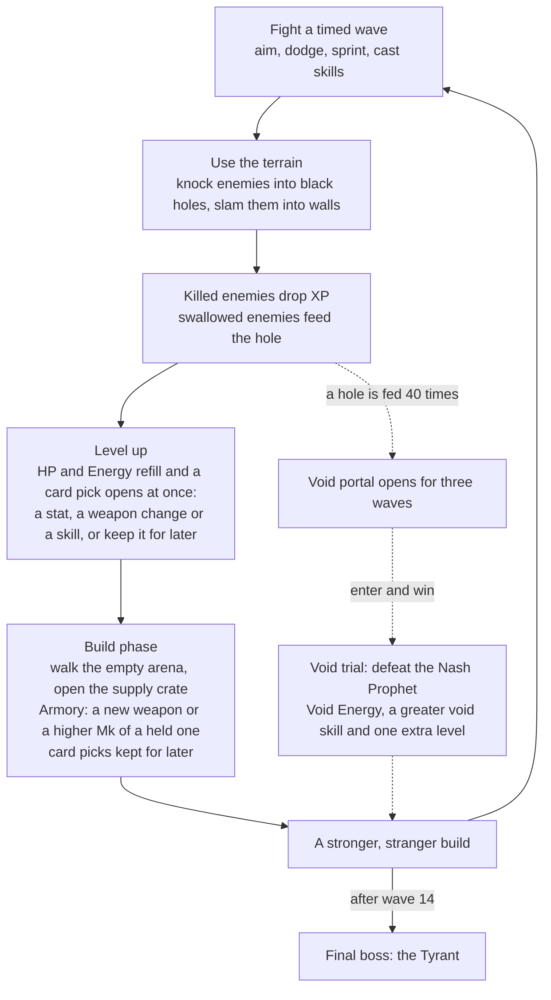

# WARP ARENA — Game Design Document

**A top-down arena survival game where your weapons misbehave and the map is your best weapon.** Knock monsters into black holes, slam them into walls, and feed a black hole until it opens a door to something worse.

| | |
|---|---|
| Genre | Top-down roguelike survival; a build grows inside each run, and the only thing that carries between runs is the player's own understanding of the game |
| View | Top-down play on a flat, bounded map; the camera follows the player and stops at the map edge |
| Platform | Web browser (Unity WebGL); mouse and keyboard |
| Engine | Unity 6 (URP) |
| A run | 14 timed waves with a build phase between them, then the final boss; roughly ten to fifteen minutes |

This document gives the big picture. The exact rules live in the system design document and every number in its companion numbers sheet; both change with tuning.

---

## 1. What the game is

Warp Arena is a roguelike survival game played in the browser with mouse and keyboard. The arena lies in warp space, and its power is behind everything strange in the game: it is what makes every weapon anomalous, it is what the skills draw on, and it shows itself on the field as black holes that swallow anything that enters them except the bosses, with the void waiting behind.

What a weapon really does, and what it costs you, stays hidden until the moment you take it. During each wave you kill for experience, experience buys levels, and levels buy the weapons, skills and stats that get you through the next wave. Survive all fourteen waves and defeat the final boss, the Tyrant King, to win.

Moment to moment you move, aim with the mouse, sprint out of trouble, swap between two hand weapons while two auto weapons act on their own, cast up to three skills, and keep looking for the wall or black hole that will do the killing for you.

## 2. Design pillars

| Pillar | How the systems deliver it |
|---|---|
| **Anomalous weapons, from first surprise to mastery.** | You pick a weapon without knowing what it does; the moment you take it, a weapon card shows the effect and its backfire. Every effect has a backfire, and nothing limits how often a weapon is used, so a trick can be practised. Later upgrades can soften a backfire, and a good player turns one into a move. |
| **The terrain is a weapon, for both sides.** | Walls deal slam damage and rebound whatever hits them. Black holes swallow everything but the bosses, enemies and player alike. Enemies path around the holes on their own, but they can be knocked in. |
| **A build of your own, inside one run.** | Two hand weapons, two auto weapons, three skills and a set of stat cards. Each wave's enemy kinds and counts and the boss are fixed, though the map tilts the mix a little, and so is the pool of weapons and skills; what changes is the build you assemble from the first pick onward. Growth inside a run is the build; growth between runs is your own understanding of the game. |

## 3. Core loop

The inner loop is fight → grow → fight harder; every turn of it makes the build stronger and stranger. The dotted branch is the optional gamble, and losing it ends the run.

## 4. A run, start to finish

1. **Pick a starting weapon.** After the title screen a supply crate comes down; click it open, with the run still frozen, to choose one of three: Rifle, Knife or Rocket Launcher. Each weapon carries one of its form's two anomalies, rolled when the weapon is made and hidden until you choose. The moment you do, the game pauses on a weapon card that explains how it fires, what it does, what element it carries and what its backfire is.
2. **Fight a wave.** A short countdown with no enemies, then they arrive on a ring around you, preferably off screen, each spawn point marked by a red cross a moment before. While the wave timer runs, killing enemies only brings the next batch, so the field stays close to full. At zero, spawning stops and the survivors must be cleared. Every level gained raises max HP and max Energy, restores HP to full, refills Energy and opens a card pick on the spot: the world freezes while you choose one of three. You can also keep the pick for later and reopen it during the wave with T.
3. **Wave end.** The field freezes. Your statuses clear (Shield stays), corpses, projectiles and leftover orbs are removed, and HP is refilled before the next wave starts. Black-hole feed counts, open portals, weapons, upgrades, skills, Energy and stats all carry over.
4. **Build phase.** Time keeps flowing, but no enemies come, weapons do not fire and you can walk the empty arena. A supply crate comes down with the Armory; click it open. The Armory offers three weapons: the first is always a new one, and the others may be a higher Mk of a weapon you hold, which upgrades that weapon in place and keeps its anomaly, upgrades and infusion. A new weapon can replace an old one, and it is revealed on its own weapon card. Then any card pick you kept during the wave is shown; one that includes a weapon card comes in a crate of its own, and rerolling it drops the crate again. A wave has exactly one reroll, shared by the picks made during the wave and in its build phase. A panel stops you where you stand; Tab puts it away so you can walk, and brings it back. Starting the next wave refills HP and stamina. Starting it with picks still open asks you to confirm, then picks at random for you.
5. **The gamble (optional).** A black hole fed 40 times collapses into a portal that stays open for three waves, or until the Tyrant fight begins, which closes it. Step on it and press E to enter the void trial, from the build phase or in the middle of a wave. Dying inside, or falling off its platform, ends the run.
6. **The end.** After wave 14 comes the Tyrant. Kill it to win; if you and the Tyrant fall in the same instant, you win. Dying anywhere else brings the result screen, and a new run starts from there.

## 5. Main systems

**The player.** Survival comes from moving and aiming by hand, not from standing still and letting the build fire. The stamina bar is deliberately short, so a sprint is a decision: get clear of a projectile or a skill, open distance, or lead enemies into a black hole. Sprinting makes you much faster; it needs a minimum of stamina and a normal state to start, then keeps going until you release the key, stop moving, are displaced or the bar runs dry; the bar shows grey while you are not sprinting and below the starting threshold. Stamina refills on its own whenever you are not sprinting. Shield comes from Earth and from Bulwark: while you have it, damage is reduced and taken from the Shield first; it is capped at a share of your max HP, except that a top-level Bulwark's own Shield stands above that cap, and it decays soon after you stop gaining it.

**States and getting hit.** Player and enemies share one set of states. Knocked back or thrown: no control until the slide nearly stops, and no resisting a black hole's pull meanwhile. A hooked or swung enemy belongs to the weapon holding it: nothing can push, pull or swallow it. The player is never hooked: the Chain Blade's pull only stops you walking, and unless tamed a knockback breaks it. Launch Yourself flight: no control, and immune to knockback only. Frozen cannot move or act. Paralysis comes in bursts: during each twitch a body can neither move nor act. Burning and poisoned only hurt. A hit from an ordinary enemy costs HP with clear feedback, a flash at the screen edge, a nudge of the camera, a flinch and a sound, but never knocks you back, so a crowd cannot take the controls away from you; only the bosses and the Stomper's slam knock you around, and a Rammer that hits you pushes you back a little and stuns you. Every hit is followed by a brief protection window; slamming into a wall ignores it.

**Damage, knockback and walls.** Damage is direct (weapons, collisions, some skills) or mechanical (statuses and the black holes, which simply kill). A hit resolves in order: a dead target ignores it; a protected target ignores it; Shield reduces it and absorbs it first; at zero HP the kill and its reward are paid once, and the corpse stays for a moment and can still be pushed into a hole; a surviving target is displaced by the attack's knockback tier; elements are applied last, and only to a living target. Tiers run from none (rapid-fire bullets, the Flying Blade, Reverse Shot) through light, medium and heavy to launch (a full Charged Shot, the landing slam of the Tyrant's charge). Bigger bodies resist more, the Spire never moves, elites resist more than their ordinary kind, and bosses cannot be moved at all, so knockback on a boss does nothing. A new knockback interrupts one in progress, so you can keep an enemy at arm's length. A knocked or thrown body that hits a wall, a pillar, the map edge or a Bulwark at speed takes slam damage, player or enemy, and rebounds with less force, sometimes into another wall or a black hole. Recoil that pushes you is not knockback and never causes slam damage. Bullets vanish on walls unless the weapon's bullets are built to bounce.

**Anomalous weapons.** A weapon is a form plus an anomaly, and each anomaly brings its own backfire. Each form has two anomalies; a new weapon rolls one of them, and the roll never changes. What you got is hidden until you choose the weapon, and then the game pauses on a weapon card, which calls the backfire its Trait. Nothing limits how often a weapon fires except cooldown, magazine and reload. You never hold two weapons of the same form. Two hand slots swap with the right mouse button, and a stowed weapon's cooldown keeps running; there is no unarmed attack. Two auto slots hold weapons that act on their own. Swapping needs a normal state: it cancels a charge, is refused while the Chain Blade is out or you are in Launch Yourself flight, flings a hooked enemy first, and is allowed while the Flying Blade is out, which then returns to its own slot.

**Weapon strength and growth.** The six anomalies of the three starting weapons are tuned to the same strength; they differ in how they aim, how much they cover, how they control and what they cost, not in damage, so no opener is best. Every other weapon follows one rule: a weapon that hits hard hits few (one target, or a line that weakens), and a weapon that hits many starts weak and grows more, because damage and element cards apply to every hit. By mid-run all four slots are full. A weapon's own damage grows only through the Armory, which offers higher Mk tiers of weapons you hold (a higher Mk only upgrades the held weapon and never changes its anomaly), while Damage and Critical stat cards raise every weapon. So a weapon raised from the start is not easily replaced, changing builds has a cost, and the Armory stays worth opening late. Weapon cards from the draft change a weapon instead of inflating it: *Infusion* adds an element the weapon leaves on enemies (a new infusion overwrites the old; a built-in element cannot be replaced; hand and auto weapons alike), *Twist* adds a new variant of the anomaly (hand weapons), *Tame* removes or softens the backfire (hand weapons). Only a revealed weapon gets cards; Twist and Tame come once each per weapon; an infused weapon occasionally sees a card that swaps its element. A weapon's slot colour climbs with its upgrades, white, green, blue, orange, and a Void-infused weapon shows black. Upgrades belong to the weapon and leave with it when it is replaced.

**Elements and Shield.** Seven elements, each with one job: two deal damage over time, two control, three buff whoever wields them. Fire, Poison, Frost and Lightning stay on the target; Earth, Light and Void give something back to the wielder. Choosing an element card or an infusion is choosing a mechanic. Shield sits in front of HP and reduces direct damage, so what kind of damage you deal matters: burn is halved by it, poison ignores it, and the Railgun's Lance ignores its damage cut but still has to get through it. Shield stops neither knockback nor status stacks. From mid-run some ordinary enemies spawn with an element affix, more of them and more kinds the later the wave, but each wave uses only two affixes, named on the wave banner before the fight; Wardens never carry one. An affixed enemy's hits put the element on you, and every status on you clears at the wave end, Shield excepted. Elites take their affix from all seven, each elite a different one. Both bosses always ignore Frost and Lightning, in every run; the Damage Penetration card lets a share of those elements' damage through, but never their statuses.

**Skills and Energy.** Up to three skills on keys 1, 2 and 3: one press, one cast, toward or at the cursor; there are no channelled, toggled or passive skills. Energy appears, full, with your first skill. Its cap rises with level and with Max Energy cards, and every time the XP bar fills, each level and each stat pick after the cap, Energy refills completely; whatever was unspent is wasted, so spend it. Beyond that, Energy comes from the Max Energy card's kill bonus, Void-infused weapons, Devour, an elite's Energy orbs and the Energy Ring's Leech blocks, and winning the void trial refills it; it goes to skills, to the hits of Void-affixed enemies and to a Leech overload. A press without Energy does nothing; each skill has a cooldown and cannot be cast again while its own effect lasts, but Energy is the real limit. While knocked back or thrown only Blink and Void Walk can be cast, and they end the slide; nothing can be cast while stunned, frozen, in a paralysis twitch or in Launch Yourself flight. Targeted skills have a maximum range, and a target inside a wall, a hole or off the map moves to the nearest legal point toward you, or the cast fails. Skills have five levels and a card's colour is the level it gives: a card for a skill you hold raises it to that level, by at least one, and with three skills held a new one replaces one of them and starts at the card's level. Seven element skills (one per element) and six mechanic skills, each basic or advanced, enter the card pool at fixed waves. After the void trial, Energy becomes purple Void Energy that regenerates on its own.

**Growth and cards.** Enemies within a wave are unlimited: the faster you kill, the faster you level and the more picks you earn, and the first levels come fast so a build takes shape early. Killed enemies drop XP orbs, which fly to you once you come within a wide reach (health and Energy orbs need you much closer); an orb that lands in a gravity ring drifts into the hole, and whatever is left on the ground vanishes at the wave end. Fodder gives a fixed amount; Spitters, Wardens and the other special enemies give more, and at the start of each wave the game sets their XP, and the elites', from each kind's health budget and that wave's difficulty, so that experience per point of enemy health stays roughly steady; an affixed Spitter gives a little more; an elite gives several times a special; summons of a boss or of the trial give nothing. The level cap is 12. Each level needs more than the last, and the final levels take a large share of the whole. Every level raises max HP and max Energy, restores HP to full, refills Energy and opens a card pick at once, freezing the world while you choose; Esc or the pick-later button keep it for later, T reopens a kept pick during a wave (not in the void trial or the Tyrant fight), and whatever is still unspent is shown in the build phase. Past the cap the bar keeps filling, and every fill gives a pick of three random stat cards. A normal pick shows three different cards: a stat card, a weapon card for a revealed weapon's untaken upgrade, and a skill card (a new skill while you hold few, mostly upgrades once you hold three). Each wave has exactly one reroll, shared by the picks made during the wave and in its build phase. Stat cards come in five rarities, common to legendary, but each stretch of waves offers only two: common or rare in waves 1 and 2, rare or exceptional in waves 3 to 8, exceptional or epic in waves 9 to 11, epic or legendary from wave 12. Most are the lower one, and a short streak without the higher one guarantees it. The card pool's rarities and skill tiers rise at fixed waves.

**Enemies and waves.** Each enemy asks the player one question, and no two ask the same: three basic roles (melee, ranged, support) and six special roles (buff, control, self-destruct, sentinel, displacement, assassin). Enemy health is set by what a normal build can put out in that wave, not by your current damage: fodder breaks at a touch, specials take a moment, elites take a while, and a boss is a fight of a minute or two, so a strong build plays faster without a weak one being walled. From mid-run enemies hit harder every wave and move slightly faster, and elites hit harder than their ordinary kind; enemies are kept deliberately slow so there is room to move and to use the terrain. They path around walls, holes and gravity rings and never walk into a hole themselves, with one exception: fast enemies follow you into a ring, where the pull outruns them, so standing just inside a ring's edge is a way to feed the hole; they follow only while you are inside the pull. The Rammer's charge turns for nothing. Wave 1 is melee enemies only: Grunts, Brutes, Skitters and Splitters; Spitters join at wave 2 and Wardens at wave 3; the specials arrive one or two kinds at a time from the early waves on, and Shades only in the last two. Early waves ramp gently so you learn the weapons and movement before the crowd. Enemies spawn on a ring around you, preferably off screen, never in a wall, a hole, a gravity ring or under your feet, each spot marked by a red cross first. Elites appear from mid-run, drawn from the six special types, at most three at once and each with a different affix; they are tougher, hit harder and resist knockback more, wear a white outline and show their kind, ELITE and their affix above the health bar, and have a small chance to drop a health or Energy orb. When the timer hits zero, spawning stops and pending spawn marks disappear, but the fight runs until the last enemy is down.

**Black holes, the portal and the void trial.** Each run has two black holes, one large and one small, placed at random from the layout's preset spots. Anything that enters one is swallowed, except the bosses: player, enemies, XP, health and Energy orbs, projectiles; a Flying Blade that falls in returns to its slot only after a wait, anything flying over it is taken, and only fields on the ground are spared. The gravity ring around a hole pulls everything but the bosses inward harder than walking, so on foot you are slowly drawn in unless you are near the Move Speed cap; a sprint crosses it, at the cost of most of your stamina. Every enemy swallowed counts once toward its hole, an elite the same as a Grunt, and a corpse pushed in counts too, as do the three enemies a short cutscene pulls in the first time a hole comes into view during a wave, but an enemy swallowed alive gives no XP: feeding is trading growth for a chance at the trial. At 40 the hole collapses, its shrinking area still killing but no longer pulling or counting, and becomes a harmless portal for three waves, not counting the one it opened in, or until the Tyrant fight begins. Only one portal exists at a time, and while it is open the other hole still pulls and kills but does not count. An unused portal expires and takes its hole with it; the other hole keeps counting, so a run gets one more chance. The trial is a circular platform floating in the void that keeps its size, with four fragments around it reached by portals, and its edge is death; entering clears your statuses and Shield. Enter from the build phase and you return to it; enter during a wave and the battlefield freezes until you come back to the portal's spot, with a short pause before the wave resumes. Winning turns Energy into self-regenerating Void Energy, gives one extra level, offers one of three greater void skills, which you may decline, and makes every black hole vanish. You carry Void only once the void boss is beaten and a void skill is equipped, a Void-infused weapon alone does not count, and from then on Light-affixed enemies hit you harder.

**The arena.** A bounded rectangle; you start at its centre, and the camera follows you until the edge. The edge and the walls block movement and projectiles, and the slam and rebound rules apply to all of them. A run starts on one of two maps, picked at random: the Dunes, with few straight walls and quicksand pools that slow walking and sprinting (not bosses), and the Ruins, with many straight, L-shaped and bracket-shaped walls. Each map has three wall layouts, and a black hole's possible positions come with the layout.

**Readability.** The wave banner names the wave's two affixes before it starts; a red cross marks every spawn point; every special or boss wind-up turns the body yellow with a sound, the Spire and the bosses' circle moves draw a warning circle, charges draw their line and the Tyrant's Tail Sweep its fan; every enemy's kind is named above its health bar, elites wear a white outline, and an enemy inside a Chanter's aura shows CHANTED; cards colour their key words so they stand out; the stamina bar greys below the sprint threshold; the Energy bar appears with your first skill and turns purple after the trial. One colour scale runs through the game: white, green, blue, purple, orange for card rarity, black for Void, weapon slots coloured by their upgrades, weapon cards by their direction (Tame green, Twist blue, Infusion purple) and skills by their level. At the cap the level reads MAX; once the trial is won the level reads purple at any level. A card panel or menu ignores clicks for a moment after opening and until the fire button is released, so a level-up in the middle of a fight never picks a card for you.

**Art and sound.** The game has two art modes. The English edition starts in whitebox, the default the course staff asked for, and a button on the title screen switches to the illustrated art; the Chinese edition has no button and is always illustrated. The switch changes the scene, the monsters, the characters and the combat effects. Menus, cards, icons and sounds are the same in both, and so are the rules: an art wall collides exactly like its whitebox box. The illustrated mode draws fire, explosions, arcs and statuses as particle effects with bloom, a black hole and a portal at their true radii, a round trial platform on a nebula, stone and sandstone walls that fill their collision boxes, a sunken quicksand pit, a burning meteor, and Bulwark as rock pushed up out of the ground. Every gun has its own recoil, screen shake, camera push and muzzle flash, the Scatter Cannon's pellets visibly fly until they hit something, and hits and deaths throw sparks and debris; the shake never moves the aim point, and hit feedback never slows or pauses the game. If the frame rate stays low in real play, the game turns the bloom off and then thins the particles. Each weapon has its own firing sound, charge sounds follow the charge and stop on release, continuous weapons loop, and reloads, slams and boss moves have their own sounds. Music and ambience play only while the player can move: every screen that holds the player fades them out, and they start from the top when the player can move again.

## 6. Content

### Hand weapons (11 forms, 22 anomalies)

| Form | Anomaly | What it does | Backfire |
|---|---|---|---|
| Rifle | Charged Shot | Hold to charge, release a round that pierces a whole line; a fuller charge hits harder and pushes farther. | You walk very slowly while charging, and enemy attacks hit you harder. |
| Rifle | Reverse Shot | Hold to fire a stream of rounds; a round bounces off a wall once; reload when the clip runs out. | Rounds fly out from your back. |
| Knife | Flying Blade | The blade bounces between a few nearby enemies, then flies back to where you stood when you threw it. | On its way back it cuts everything on its path, enemies and you alike. |
| Knife | Chain Blade | Hooks an enemy and pulls it in front of you as a shield that stops projectiles; click again to fling it into other enemies, into walls or into a black hole. | As it pulls the enemy in, it drags you toward the enemy too: you meet halfway. |
| Rocket Launcher | Strike | Marks the ground under the cursor; a moment later a rocket falls and blasts the area. | The blast is delayed, and it hurts you and enemies alike. |
| Rocket Launcher | Launch Yourself | You become the rocket and hit every enemy on the way. | Hitting a wall costs HP; a black hole on the path swallows you. |
| Scatter Cannon | Blast | Two heavy blasts in a short cone; the closer, the more it hurts; two shots per reload. | Each reload throws two hot shells to the ground at your sides; a moment later they flare up into small fires that burn whoever steps on them, you included. |
| Scatter Cannon | Focus | Hold to gather all the pellets of one shell into a single point, then fire them as a rapid burst that reaches far. | The recoil shoves you a long way back in one go; a wall behind you does not hurt. |
| Flamethrower | Stream | Hold to spray fire forward and ignite the enemies in the cone. | If you are hit while spraying, the tank on your back bursts, burning the enemies around you and setting you alight. |
| Flamethrower | Wildfire | Lobs a fireball that leaves a patch of burning ground where it lands. | Standing in your own fire burns you too. |
| Cryo Cannon | Shatter | Fires three flying ice shards in a fan, at most one per enemy each shot; a frozen target takes double damage. | Where a shard stops it leaves an ice patch; you and enemies slip on it, starting, stopping and turning only gradually (not bosses or Spires). |
| Cryo Cannon | Blizzard | Hold to spray snow; enemies freeze quickly and stay frozen while you keep spraying. | Snow builds up at your feet; standing in it stacks Frost on you, never enough to freeze. |
| Arc Cannon | Arc Jump | An arc hits the nearest enemy in a cone ahead of your aim, then jumps several times between nearby enemies, never through a wall; with no enemy ahead it does not fire (built-in Lightning). | The jumps that find no target come back into you, and enough of them paralyse you. |
| Arc Cannon | Capacitor | Charges as you walk with it in your hand, faster with enemies close by; click to release all of it on everything around you, harder when full. | Held full too long, it discharges into you by itself; stowed, it slowly loses its charge and never discharges. |
| Venom Launcher | Cloud | Lobs a pod that bursts into a long-lingering poison cloud (built-in Poison). | The fading cloud leaves spore pods that burst under whoever steps on them: enemies are poisoned, and you lose HP. |
| Venom Launcher | Needler | Hold to fire poison needles, each stacking Poison; reload when the clip runs out. | Each reload bursts a small poison mist where you stand: enemies in it are poisoned, and you lose HP while you stay in it. |
| Railgun | Lance | A short wind-up, then a rail beam that pierces a line and ignores the Shield's damage cut; each target behind the first takes less. | The recoil shoves you far back, maybe into a crowd or a black hole (a wall behind you does not hurt), and you move at half speed during the wind-up. |
| Railgun | Execute | A single very heavy shot that executes low-HP enemies outright; a kill gives part of the cooldown back and makes the next shot hit harder. | A shot that kills nothing (a boss it hits does not count) shocks you and puts the gun on a long cooldown. |
| Gatling | Spin-up | Hold to fire; the rate climbs as it spins. | The faster it spins, the slower you can turn your aim, and it slowly pushes you back; a wall behind you does not hurt. |
| Gatling | Meltdown | Full rate from the first shot, but sustained fire builds heat. | Overheating explodes around you and stops the gun for a while. |
| Swarm Launcher | Barrage | A swarm of micro-missiles that home in on nearby enemies. | Each missile locks a different visible enemy; with too few, some spare missiles lock onto you and turn back to blast you, and the rest fly straight on. |
| Swarm Launcher | Bombard | A string of blasts walks away from you in a straight line. | The first blast is right in front of you; walk forward and you walk into it. |

### Auto weapons (3 forms, 6 anomalies)

| Form | Anomaly | What it does | Backfire |
|---|---|---|---|
| Orbit Blades | Closed Blade | Blades circle you; enemies they touch are hurt and pushed outward. | They also knock pickups (XP, health and Energy orbs) and corpses away. |
| Orbit Blades | Open Blade | Blades circle you; enemies they touch are hurt and pulled inward. | Enemies get dragged right into your face. |
| Sentry Drone | Gunner | The drone fires rapidly at nearby enemies on its own, a magazine at a time. | When a magazine runs dry the drone drops to the ground to cool down; step on it to send it back up, or wait. |
| Sentry Drone | Whirl | The drone's tractor beam drags a lone distant enemy, throws it and slams it down; it and the enemies where it lands take damage. | It always slams the enemy where you stood a moment ago; your afterimage marks the spot. |
| Energy Ring | Deflect | A force field: enemies close to you move slower, incoming projectiles may be deflected and fizzle, and enemies in it take a light hit now and then, which is how an infused element gets onto them. | Your own bullets and lobbed shots leaving the ring may also be knocked off course at its edge. |
| Energy Ring | Leech | After a while without an enemy hit it raises an Energy Shield that blocks one hit and gives you Energy; once infused, each block also releases a burst of its element on nearby enemies. | Take another hit soon after the shield breaks and you lose Energy. |

### Elements

| Element | Kind | On the target (your weapons and skills) | As an enemy affix |
|---|---|---|---|
| Fire | Damage over time | A burn, not stacks: each hit renews it for a few seconds, and its strength follows the weapon's damage output; reduced by Shield | Its hits set you burning |
| Poison | Damage over time | Stacks of damage over time that ignore Shield; the stacks stay while hits keep coming and drain away shortly after the last hit | Its hits poison you |
| Frost | Control | Slows movement and attacks; at full stacks the target freezes and takes extra damage; fades over time | Its hits stack Frost on you |
| Lightning | Control | Spreads between targets; each stack makes the enemy take more damage and twitch now and then; at full stacks it is paralysed in bursts and takes the most extra damage; stacks fade soon after the last hit | Its hits stack Lightning on you |
| Earth | Buff | Gives the wielder Shield | It spawns with Shield |
| Light | Buff | Heals the wielder for a share of its damage; counters Void | It heals for a share of the damage it deals, and hits a Void carrier harder |
| Void | Buff | Restores the wielder's Energy | It acts more often, and its hits drain your Energy |

### Skills (13, plus 3 greater void skills)

| Skill | Element · tier | What it does | Levelling up |
|---|---|---|---|
| Flame Wake | Fire · basic | For a while a burning trail follows you; enemies that touch it catch fire | Lasts longer and burns harder; at max level the trail is wider |
| Contagion | Poison · basic | Poisons nearby enemies; for a while, a poisoned enemy that dies passes its poison to a neighbour | Lasts longer and poisons more; at max level each death infects two |
| Frost Nova | Frost · basic | Stacks Frost on everything around you; fodder freezes on the spot | Bigger, with more Frost; at max level the freeze lasts longer |
| Storm Call | Lightning · basic | Random lightning strikes near the cursor, hurting and stacking Lightning | More bolts over a wider area, each hitting harder and stacking more Lightning; at max level a bolt that hits chains to nearby enemies |
| Bulwark | Earth · basic | Raises a wall at the cursor that knocks back enemies touching it, and gives you Shield scaled to your max HP. Only a boss can break it: the Tyrant King's charge or the Nash Prophet's pulse | Thicker Shield, farther knockback, longer wall; at max level the Shield is very thick |
| Radiance | Light · advanced | Clears every status on you; for a while your attacks heal you and you resist statuses | Longer, more resistance; at max level it also heals at once |
| Devour | Void · advanced | Swallows one weakened enemy nearby and restores Energy | A higher health threshold; at max level a shorter cooldown |
| Blink | Mechanic · basic | Teleports you toward the cursor and cancels a knockback in progress | Farther; at max level two uses |
| Shockwave | Mechanic · advanced | Shoves every enemy around you hard | Bigger; at max level it also reflects enemy projectiles |
| Gravity Well | Mechanic · advanced | A well at the target that pulls nearby enemies to its centre for a while | Longer; at max level it explodes when it ends |
| Time Stop | Mechanic · basic | Everything but you slows down for a while | Longer; at max level your attacks are faster meanwhile |
| Mirror Image | Mechanic · advanced | Places a mirror of you that enemies chase | Longer; at max level it casts a random other skill when it ends |
| Overcharge | Mechanic · basic | All your weapons fire much faster for a while | Longer; at max level it also adds damage |

The greater void skills appear only after the trial is won, as a choice of one from three, and never level up.

| Greater void skill | What it does |
|---|---|
| Pocket Void | Opens a small black hole at the cursor that swallows anything but a boss, and you receive the XP of what it swallows |
| Void Walk | You slip into the void: faster, untargetable and unhurtable, breaking any knockback; when it ends, both hand weapons carry Void for a few seconds |
| Singularity | For a few seconds you are fully invincible and heavily slowed but can still move, fire and cast; every enemy on screen is dragged toward you and slowed, then you explode; the more pulled in, the more it hurts |

### Stat cards

| Card | Main effect | Side effect |
|---|---|---|
| Max HP | More max HP, and heals the same amount when taken | Heals a little over time |
| Move Speed | Walk faster | Sprint lasts longer |
| Damage | Direct damage up, skills included | — |
| Attack Speed | Shorter weapon cooldowns | — |
| Critical | Crit chance up | Crit multiplier up |
| Protection | Armour that reduces the damage you take | — |
| Max Energy | Higher max Energy (appears once Energy is unlocked) | A little Energy for every enemy that dies |
| Damage Penetration | Part of your element damage gets through to targets immune to it; statuses still never land. Offered only if you use an element the bosses ignore, from wave 11 on or while a void portal is open | — |

### Enemies

| Enemy | Role | Behaviour |
|---|---|---|
| Grunt | Basic · melee | Walks up, locks its facing and punches. Three bodies: the Brute winds up long, hits hard and is slow; the Skitter is fast with a short wind-up but weak; the Splitter sits between them and splits into small Splitters when killed. |
| Spitter | Basic · ranged (from wave 2) | Keeps its distance, charges when it has line of sight, and fires a poison spike. |
| Warden | Basic · support (from wave 3) | Never attacks; hides behind allies and shields those around it, topping them up over time. Never carries an affix. |
| Chanter | Special · buff | Never attacks; hides behind allies and chants, raising the damage of every ally in range. |
| Rammer | Special · control | Draws a charge line, then charges along it without turning; a player it hits is pushed back a little and stunned. A wall stuns it; a black hole swallows it. |
| Bloater | Special · self-destruct | Walks at you; within about 7 cells it turns yellow and rushes you, then swells and explodes almost as soon as it reaches you, hurting everything; it explodes when killed too, and leaves a radiation patch that hurts you. |
| Spire | Special · sentinel | Never moves. Draws a warning circle, sends out a pulse that hurts only the player, then locks on a player inside the circle and fires a laser. |
| Stomper | Special · displacement | Closes in, winds up and slams a small cone in front of it toward you, launching everything in it; you are thrown far back. Spawns with Shield, away from the crowd. |
| Shade | Special · assassin | Announces itself with its own colour and sound, shows for a moment, then cloaks; its strike can kill you outright. Any damage reveals it, its health is very low, and only a few exist at once. |

### Bosses

| Boss | Where | What it tests |
|---|---|---|
| The Nash Prophet | The void trial | Positioning and dodging on a platform that keeps its size. It stands still in the middle, has no Shield, is always immune to Frost and Lightning and cannot be pushed; its summons give no XP. Up close it fires a repulse pulse that throws you into the void if it catches you in the outer part of its circle, summons Wardens (Shades in its last phase) that keep it invulnerable while any of them lives, or fires rings of bullets. At range it fires rings; from its second phase also predictive volleys, void pillars that kill you if you stand inside one, and a gravity pull that drags you toward them. Four portals on the platform (E while standing on one) lead to small fragments around it. |
| The Tyrant King | After wave 14; counts as wave 15 for damage growth | The whole build: a thick single target that starts with a Shield (do you have high damage or Shield-piercing?) and always ignores Frost and Lightning (is your damage one-note?). It has two phases: below half HP it refills its Shield once, hits harder, moves more often, gains new moves and calls in crowds (do you have area damage?). It is never stunned, knocked back, pulled or swallowed, and its hits knock you back. It picks moves by distance: up close a tail sweep that breaks the walls it touches (from phase 2 also a ground pound down a long rectangle); at mid range a charge that smashes walls and Bulwarks, knocks enemies aside and ends in a leap and slam (from phase 2 also a scepter that calls a crowd); from afar a thrown meteor whose fragments stand as walls for a while (from phase 2 also devouring nearby minions for HP and Shield). |

### Maps

A run starts on one of two maps, each with three wall layouts picked at random: the Dunes (few walls, quicksand, more Bloaters and Spires) and the Ruins (many walls, more Rammers).

## 7. Controls

| Action | Input |
|---|---|
| Move | WASD |
| Aim | Mouse |
| Use the held weapon | Left mouse button (hold to charge or to keep firing, depending on the weapon) |
| Swap the two hand slots | Right mouse button |
| Sprint | Hold Shift |
| Cast a skill / select a card while a card panel is open | 1, 2, 3 |
| Reopen a card pick kept for later (during a wave) | T |
| Put the build panel away to walk the empty arena, and bring it back | Tab |
| Enter the void trial | E while standing on the portal |
| Start, open the crate, start the next wave, switch art mode | Left mouse button on the button or crate |
| Close the weapon card | Space, Enter or a click |
| Pause / resume; keep a mid-wave pick for later | Esc |
| Reroll while a card panel is open (once per wave) / restart on the result screen | R |

## 8. External References

AI tools used in making the game and this document:

| Tool | Used for |
|---|---|
| Meshy | 3D models and character animation for the optional illustrated mode |
| ElevenLabs | Sound effects and music |
| GPT Image 2.5 | 2D illustrations and concept art for the optional illustrated mode, and references for the Meshy models |
| Codex | Weapon, skill, stat and element icons, shown in both art modes |
| Claude | Building the UI and VFX, and bringing these art assets into the game |

Other external software, packages and assets (versions from the project's package manifest):

| Resource | Version | Used for |
|---|---|---|
| Unity | 6000.6.3f1 | Game engine and WebGL build |
| Universal Render Pipeline (`com.unity.render-pipelines.universal`) | 17.6.0 | Rendering |
| Input System (`com.unity.inputsystem`) | 1.20.0 | Mouse and keyboard input |
| Localization (`com.unity.localization`) | 1.5.13 | English and Chinese UI text |
| uGUI (`com.unity.ugui`) | 2.6.0 | HUD and menus |
| Cinemachine (`com.unity.cinemachine`) | 6.6.0 | Installed camera package |
| Test Helper (`com.nowsprinting.test-helper`, via OpenUPM) | 1.6.4 | Helpers for the automated Play Mode tests |
| Noto Sans CJK SC (SIL Open Font License 1.1) | — | UI font for English and Chinese text; the web builds ship a subset cut with fontTools |
| Blender | 5.2 | Rigs and clips for the nonhuman enemies' Meshy models; cutting the Chanter model for the web build |
| fontTools | 4.62.1 | Cutting the UI font down to a subset for the web build |
| Unity Labs VFX flipbooks | CC0 | Explosion, smoke and cloud effect textures |
| Unity Particle Pack (Asset Store) | Asset Store licence | Fire, energy, shock and debris effect textures |
| Kenney Particle Pack | CC0 | Muzzle, spark, slash and smoke effect textures |
| ambientCG: PavingStones149, Ground108, Rock023, Rock029 | CC0 | Ground and wall surfaces |
